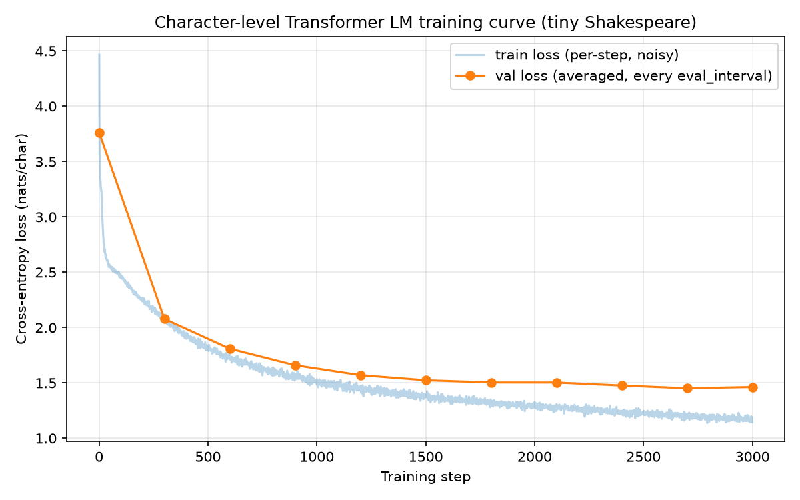

# Transformer From Scratch (PyTorch)

A decoder-only (GPT-style) Transformer built up **one component at a time**
across **six modular development stages**, from embeddings to training.
The attention implementations are checked against PyTorch references;
other stages include formula, shape, gradient, and behavioral checks.
The model implements multi-head self-attention, causal masking, sinusoidal
positional encoding, and autoregressive text generation.

The model is trained on character-level **tiny Shakespeare**. The saved
`loss_curve.png` shows held-out validation cross-entropy falling from
approximately **3.76 to 1.46 nats/character** over **3,000 training steps**,
an approximately **61% reduction**. These values are estimates read from the
plot, not exact logged metrics. The saved `final_sample.txt` demonstrates
dialogue formatting and partially coherent text, with remaining grammatical
and semantic errors.

---

## Why this project is structured the way it is

Each stage's `if __name__ == "__main__":` block runs sanity checks. Stages
2–3 numerically compare attention outputs against **PyTorch reference
implementations**. Stage 1 checks the positional encoding formula; stages
4–5 check shapes, gradients, causal behavior, weight tying, and generation.
Stage 6 checks that final validation loss is below 70% of the uniform-random
baseline. Each stage script is runnable directly and prints a ✅ message
when its checks pass, or raises an assertion if a check fails.

This structure mirrors how I'd want to explain the project in an interview:
build up complexity in verifiable, isolated steps, rather than one large
opaque model class.

---

## File-by-file breakdown

| File | What it builds | Sanity check |
|---|---|---|
| `stage1_embeddings.py` | Token embedding (scaled by √d_model) + sinusoidal positional encoding | Shapes verified; positional encoding values hand-checked against the closed-form `sin`/`cos` formula from "Attention Is All You Need"; sin²+cos²=1 structural check |
| `stage2_attention.py` | Scaled dot-product attention: `softmax(QKᵀ/√d_k + mask) @ V`, plus causal mask construction | Output compared against `torch.nn.functional.scaled_dot_product_attention`, with and without causal masking (`torch.allclose`, `atol=1e-5`); verifies causal mask fully blocks future positions; verifies attention weights are a valid probability distribution |
| `stage3_multihead.py` | Multi-head attention: splits Q/K/V into heads, runs Stage 2 attention per head (batched), concatenates, projects | Weights copied into `torch.nn.MultiheadAttention` for comparison using the same parameters and inputs (`torch.allclose`, `atol=1e-4`), masked and unmasked; shape check on a second, different configuration |
| `stage4_block.py` | Full Pre-LN Transformer block: LayerNorm → causal self-attention → residual add, then LayerNorm → feed-forward (GELU) → residual add | Shape checks; verifies gradients flow to the input; verifies causal masking still holds after passing through the *entire* block (perturbing a future token doesn't change earlier outputs) |
| `stage5_transformer.py` | Full model: embeddings → stack of N blocks → final norm → output projection, with **weight tying** between the input embedding and output projection, and a `generate()` method | Verifies weight tying is a literal shared tensor (not just equal values) with shared gradients; verifies `generate()` produces the correct token count; verifies context-window cropping prevents any forward pass from ever exceeding `max_seq_len`, even after generating far beyond it |
| `stage6_train.py` | Character-level training loop on tiny Shakespeare: custom char tokenizer, train/val split, AdamW + gradient clipping, periodic loss logging + sample generation, loss curve plot | Asserts final validation loss is below 70% of the uniform-random baseline `ln(vocab_size)` |

Supporting files:

- `requirements.txt` — the two dependencies needed (`torch`, `matplotlib`)
- `tinyshakespeare.txt` — auto-downloaded by `stage6_train.py` on first run (not needed to be present beforehand)
- `chat.py` — interactive prompt-based generation using `transformer_lm.pt` and the current training architecture

---

## Setup instructions

```bash
# 1. Clone / download this project, then create a virtual environment
python -m venv venv
source venv/bin/activate   # on Windows PowerShell: .\venv\Scripts\Activate.ps1

# 2. Install dependencies
pip install -r requirements.txt

# 3. Run stages from the project directory; later stages import earlier ones.
python stage1_embeddings.py
python stage2_attention.py
python stage3_multihead.py
python stage4_block.py
python stage5_transformer.py

# 4. Run training (downloads tiny Shakespeare automatically if missing;
#    runtime depends on hardware and the settings in stage6_train.py)
python stage6_train.py
```

Each of stages 1–5 prints its own sanity check and exits with a `✅` message
on success (or an `AssertionError` with a clear message on failure). Stage 6
trains the full model, prints train/val loss and a text sample every
`eval_interval` steps, then saves:

- `loss_curve.png` — training/validation loss over time
- `final_sample.txt` — a longer generated sample after training
- `transformer_lm.pt` — the trained model's weights

If you have a GPU available, `stage6_train.py` will automatically use it
(`device = "cuda" if torch.cuda.is_available() else "cpu"`). The current
defaults use a 6-layer model with width 384 and a batch size of 64, so CPU
training may take substantially longer than a small demonstration run.
Reduce the model dimensions, context length, or batch size if needed for
your hardware. Running training overwrites the three output files above.

After training, run `python chat.py` to generate text from an entered prompt.
Its model settings must match the checkpoint; if you change the training
architecture, update `chat.py` accordingly. Enter a non-empty prompt using
characters from the training corpus; unsupported characters raise a
`KeyError`. Press Ctrl+C to exit.

---

## Current training configuration

These are the settings currently defined in `stage6_train.py`; the saved
plot alone does not establish every setting used for its run.

| Setting | Value |
|---|---|
| Tokenization | Character-level, 65-character vocabulary |
| Train/validation split | First 90% / last 10% of the tokenized corpus |
| Context length / batch size | 256 / 64 |
| Model width / attention heads / Transformer blocks | 384 / 6 / 6 |
| Feed-forward width / dropout | 1,536 / 0.1 |
| Optimizer / learning rate | AdamW / `3e-4` (constant) |
| Gradient clipping | Global gradient norm capped at 1.0 |
| Training steps | 3,000 |
| Validation evaluation | After step 1 and every 300 steps; mean loss over 20 sampled validation batches |
| Final generation | Prompt `ROMEO:`, 400 new characters, temperature 0.8, top-k 20 |

The six development stages are the six source modules, distinct from the
six Transformer blocks configured for training.

## Results from the saved artifacts



The orange validation curve in `loss_curve.png` falls from approximately
**3.76 nats/character** at the first evaluation to approximately
**1.46 nats/character** at step **3,000**. This is an approximately **61%**
relative reduction: `(3.76 - 1.46) / 3.76 × 100 ≈ 61.2%`.
The blue curve shows per-step training loss, not validation loss.

For the dataset's 65-character vocabulary, **uniform-random guessing** has
cross-entropy `ln(65) ≈ 4.17 nats/character`. This is a theoretical reference,
not the measured starting validation loss of this run. The script's first
validation evaluation occurs **after the first optimizer update**, rather
than before training.

The numerical results above are visual estimates from the saved PNG. Raw
loss logs, intermediate generated samples, run hardware, and elapsed time
are not recorded in these artifacts, so exact metrics and a runtime claim
cannot be recovered from them.

**Final generated text, copied from `final_sample.txt`:**

```text
ROMEO:
It were ministives must with my house.

MERCUTIO:
Well, thou art thus my father's mind. I slain,
and thou bear me thy chants, at thy pire attend
things, and to understand do thy deeds; and
therefore no party, though the fearful soul stand
upon him backful of fancy, and his life to rage at
the shepherd, when 'twas a plot in his sake gentle
battle soldiers, the curbs and find the people storms
hour
```

The sample shows dialogue labels, recognizable words, punctuation, and
partially coherent phrases, alongside invented words and inconsistent
grammar and meaning. It illustrates generation behavior; the loss curve
provides the quantitative evidence of learning.

---

## What I'd improve next

This project deliberately prioritizes **correctness and clarity of the core
Transformer mechanics** over state-of-the-art results. Possible next
experiments include:

1. **Scale up training compute**: more steps, a larger `d_model`/`num_layers`,
   and a longer `block_size` (context window), then measure the effect on
   validation loss, generated text, runtime, and memory use.
2. **Learning rate schedule**: compare warmup + cosine decay against the
   current flat learning rate, measuring stability and final validation loss.
3. **Subword tokenization (BPE)** instead of character-level: would let the
   same context window cover more text. Compare validation results and
   generation quality while accounting for the different tokenization.
4. **KV-caching for generation**: currently `generate()` recomputes the full
   forward pass at every new token. Explore caching past keys/values,
   handling positional encoding and context-window cropping carefully.
5. **Mixed precision / `torch.compile`**: benchmark training throughput and
   memory use on compatible hardware, and check numerical stability.
6. **RoPE or ALiBi positional encoding**: one experiment would be a Stage 1b comparing
   the sinusoidal encoding here against a RoPE implementation head-to-head.
7. **Proper hyperparameter sweep** (learning rate, dropout, batch size)
   rather than the manually-picked values used here.

---

## What this project demonstrates (for interview conversations)

- Understanding of *why* each architectural choice exists (scaling by
  √d_k, residual connections, Pre-LN vs Post-LN, weight tying, causal
  masking), not just how to implement it — see the extensive docstrings
  in each stage file.
- Ability to verify a from-scratch implementation numerically against a
  trusted reference implementation, a good habit for any ML engineering
  role.
- Practical training-loop engineering: train/val split, gradient clipping,
  periodic evaluation, and a documented, defensible check that the model is
  actually learning (loss vs. random baseline) rather than just "the code
  ran without crashing."
- Awareness of the model's current limitations and a concrete, prioritized
  plan for what to do next — knowing what to improve is as important as
  what's already been built.
